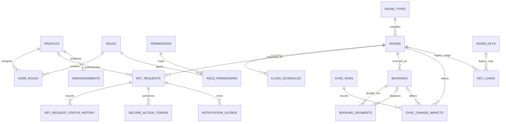

# Approved Baseline Database ERD

This diagram shows the additive baseline structures. Existing RBAC, room, booking, key-loan, notification, and audit tables remain authoritative during transition.

## Key invariants

- `no_overlapping_active_key_requests` prevents overlapping pending, approved, or in-use requests for the same room.
- `key_requests.authenticated_user_id` is nullable for ordinary laboratory requests but mandatory at the RPC boundary for room types requiring SSO.
- `booking_segments` retains unaffected intervals after a priority displacement.
- `secure_action_tokens` stores only token digests; expiry and one-time use are checked under row lock.
- `notification_outbox.idempotency_key` prevents duplicate logical delivery jobs.
- `room_keys` and `key_loans` are preserved for compatibility and historical data, but new baseline requests do not depend on them.
