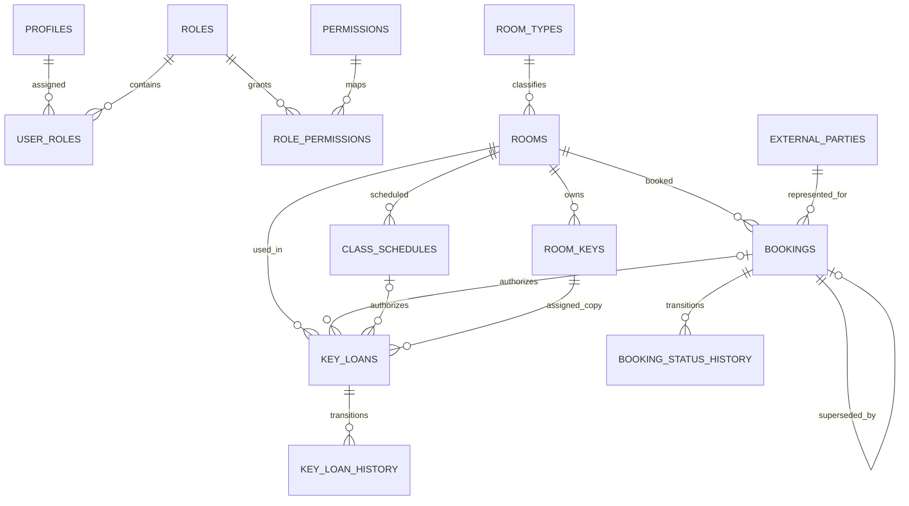

# Requirements V2 — Database Gap Analysis และแผนปรับโครงสร้าง

เอกสารนี้อธิบายการเปลี่ยนแปลงแบบ incremental ใน migrations `0005`–`0007` โดย migrations `0001`–`0004` และข้อมูลเดิมยังคงอยู่ การเปลี่ยนแปลงนี้ยังไม่ได้ apply ไปยัง Supabase Cloud

## สถานะข้อกำหนด

- **Confirmed Requirement:** รองรับ auto-confirm, special-room approval, Cold Room restriction, booking override เฉพาะ booking ปกติ, key usage จาก booking/class/direct usage, self-return report, Staff read-only และเวลา 08:30–17:30
- **Engineering Implementation Decision:** ตีความ advance limit 3 วันเป็น rolling exact duration ชั่วคราว และบันทึกใน `booking_rules`
- **Pending Business Decision:** ต้องยืนยันว่า “3 วัน” คือ calendar days หรือ 72 ชั่วโมง และ Priority User จะ override protected schedules ได้หรือไม่
- **Technical Blocker:** ยังไม่มี provider configuration ของระบบบัญชีมหาวิทยาลัย และยังไม่มี Auth test users สำหรับทดสอบ RLS แบบ end-to-end

## Schema gap analysis

| Existing table | Current purpose | V2 requirement | Classification | Required modification | Reason / impact |
|---|---|---|---|---|---|
| `organizations` | หน่วยงานของ profile | REQ-06,12 | KEEP_AS_IS | ไม่มี | รองรับ affiliation อยู่แล้ว / Low |
| `roles` | RBAC roles | REQ-04,05 | EXTEND | เพิ่ม `ADMIN`, `PRIORITY_USER` | แยก Staff จาก Admin / High |
| `permissions` | RBAC permissions | REQ-04,05 | EXTEND | เพิ่ม read, override, direct-key, on-behalf permissions | least privilege / High |
| `role_permissions` | role mapping | REQ-04,05 | MODIFY | ถอนสิทธิ์ admin ของ STAFF; map ADMIN/Priority | ป้องกัน privilege escalation / High |
| `profiles` | Auth-linked identity | REQ-06 | EXTEND | provider/subject/verified timestamp | รองรับ identity mapping โดยไม่สมมติ protocol / Medium |
| `user_roles` | user-role assignment | REQ-04,05,06 | KEEP_AS_IS | ไม่มี | โครงสร้างยืดหยุ่นและ client เขียนไม่ได้ / High |
| `room_types` | ประเภทห้อง | REQ-02,11 | EXTEND | `booking_policy`, student eligibility | config ตามประเภท ไม่ hardcode room id / High |
| `rooms` | room catalog | REQ-02,07,13 | KEEP_AS_IS | ไม่มี | ใช้ type policy และ sanitized RPC / Medium |
| `equipment` | equipment catalog | — | KEEP_AS_IS | ไม่มี | ไม่กระทบ V2 / Low |
| `room_equipment` | room/equipment M:N | — | KEEP_AS_IS | ไม่มี | ไม่กระทบ V2 / Low |
| `class_schedules` | teaching schedules | REQ-01,07,10 | EXTEND | รองรับ `ADMIN_ALLOCATION`, status, effective dates, actor | ใช้ตารางเดิมแทนสร้าง schedule ซ้ำ / High |
| `room_blocks` | blocked periods | REQ-05,10 | KEEP_AS_IS | ยังคงเป็น protected conflict | Priority override ข้ามไม่ได้ / High |
| `room_operating_hours` | optional per-room hours | REQ-09 | KEEP_AS_IS | global rule ยังอยู่ใน rules | รองรับ exception ในอนาคต / Medium |
| `bookings` | booking lifecycle | REQ-02,05,12 | EXTEND | actor, beneficiary/external person, supersession link/reason | audit delegation และ override / High |
| `booking_approvals` | approval history | REQ-02 | KEEP_AS_IS | reuse สำหรับ special rooms | ไม่เพิ่มตารางซ้ำ / Medium |
| `booking_status_history` | booking transitions | REQ-05,14 | EXTEND | รองรับ `SUPERSEDED` enum | เก็บ displaced booking / High |
| `room_keys` | physical key copies | REQ-08 | EXTEND | tracking mode, permanent custodian | แยก housekeeper permanent keys / High |
| `key_loans` | key usage lifecycle | REQ-01,03,12 | MODIFY | booking optional; room/source/schedule/actors/return evidence | ไม่บังคับ duplicate booking / High |
| `key_loan_history` | loan transitions | REQ-03,14 | EXTEND | รองรับ `RETURN_REPORTED` | แยก user report จาก physical verification / High |
| `key_incidents` | lost/damaged/late | REQ-14 | KEEP_AS_IS | ไม่มี | รองรับ abnormal flow แล้ว / Medium |
| `key_compensations` | compensation | REQ-14 | KEEP_AS_IS | ไม่มี | รองรับ reporting แล้ว / Medium |
| `notifications` | user notifications | REQ-05 | KEEP_AS_IS | reuse สำหรับ superseded booking | แจ้งผู้ถูกแทนที่ / Medium |
| `notification_deliveries` | channel delivery | — | KEEP_AS_IS | ไม่มี | ไม่กระทบ V2 / Low |
| `booking_rules` | configurable rules | REQ-09 | MODIFY | 3 days, 08:30, 17:30, interpretation | ไม่กระจาย constants / High |
| `system_settings` | system config | REQ-09 | KEEP_AS_IS | ใช้ timezone เดิม | `Asia/Bangkok` มีอยู่แล้ว / Medium |
| `holidays` | holiday exceptions | REQ-09,10 | KEEP_AS_IS | ไม่มี | ไม่มี blanket weekday rule / Medium |
| `audit_logs` | immutable audit trail | REQ-03,05,12,14 | KEEP_AS_IS | RPCs เพิ่ม event ใหม่ | รักษา actor และ history / High |
| `external_parties` (new) | บุคคลภายนอกที่ Admin เป็นผู้แทน | REQ-12 | EXTEND | ตารางใหม่ ไม่มี Auth account ปลอม | relational identity สำหรับ external booking / High |

ไม่มีตารางใดถูกจัดเป็น `DEPRECATE_CANDIDATE` หรือถูกลบ

## ความสัมพันธ์หลังการเปลี่ยนแปลง

`key_loans.usage_source` กำหนดว่า reference ที่ถูกต้องคือ `booking_id`, `class_schedule_id` หรือ `authorized_by` สำหรับ `DIRECT_USAGE` โดยมี CHECK constraint บังคับรูปแบบ

## RBAC matrix

| Category | Read rooms/safe availability | Own booking | Cold Room booking | Special approval | Override ordinary booking | Manage schedules/keys/users | Operational summary |
|---|---:|---:|---:|---:|---:|---:|---:|
| Guest | Yes, sanitized RPC | No | No | No | No | No | No |
| Student | Yes | Ordinary rooms | No | No | No | No | Own records |
| Teacher | Yes | Yes | Auto-confirm | No | Only if separately granted Priority role | Class-authorized key use | Own records |
| Priority User | Yes | Normal account permissions | Depends on base role | No | Yes, bookings only | No | Own records |
| Staff | Yes | No elevated access | No | No | No | No | Read-only sanitized summary |
| Admin | Yes | Yes/on behalf | Yes | Yes | Yes | Yes | Yes |

Priority authority is a narrow permission and does not imply Admin. Guest QR links are navigation only; `list_public_room_availability` returns sanitized data and grants no booking/key authority.

## Booking workflow V2

1. `create_booking` validates Auth, room, conflict, rolling 3-day limit, and 08:30–17:30 in `Asia/Bangkok`.
2. `AUTO_CONFIRM` room types create `APPROVED`; Studio/Gaming/E-learning create `PENDING`.
3. Cold Room rejects users who are neither Teacher nor Admin.
4. `override_booking` locks an approved non-priority booking/room, rejects any class/admin/block conflict, marks the old booking `SUPERSEDED`, creates a priority replacement, history, notification, and audit in one transaction. Priority bookings cannot recursively replace one another.
5. No Wednesday/Thursday rule is hardcoded.

## Key workflow V2

`borrow_key` supports `BOOKING`, `CLASS_SCHEDULE`, and `DIRECT_USAGE`. It assigns one tracked physical copy and creates a checked-out loan atomically without a manual approval stage. A Teacher may nominate a different borrower for that Teacher's active class schedule; arbitrary delegation remains forbidden.

`confirm_key_return` records user evidence as `RETURN_REPORTED` and changes the key to `RESERVED`, not `AVAILABLE`, so the system does not imply independent physical verification or allow double checkout. `return_key` remains an Admin/`KEY_MANAGE` verification path and records physical verification separately.

Keys marked `EXCLUDED_PERMANENT` are excluded from ordinary borrowing and overdue tracking.

## Reporting

`booking_report_v` and `key_loan_report_v` support date, room, user, status, override, cancellation, and overdue filters. They are `security_invoker` views, so base-table RLS still applies. Excel generation remains an application concern.

## Migration sequence and safety

1. `0005_v2_schema_rbac.sql`: enum additions, additive columns/table, backfills, constraints, RBAC, rules.
2. `0006_v2_workflow_functions.sql`: replaced compatible RPC definitions and added trusted V2 RPCs.
3. `0007_v2_rls_views_indexes.sql`: policies, safe Guest function, reports, views, and indexes.

Backfills preserve all booking and loan rows. No table or business record is dropped. Index replacement is transactional and expands active-loan protection to `RETURN_REPORTED`.

Rollback should use a database backup/PITR or a separately reviewed forward migration. Do not manually reverse enum additions or drop populated columns. Before Cloud approval, take a backup, test on a disposable database, regenerate `database.types.ts`, and validate Auth personas.

## Open requirements and blockers

- **PENDING-01:** Priority User override of class schedules or Admin allocations is not authorized. Current implementation fails safely.
- **PENDING-02:** Confirm calendar-day versus rolling 72-hour interpretation of the 3-day limit.
- **PENDING-03:** University IdP protocol, issuer, claims, account lifecycle, and verified provider configuration are unavailable.
- **PENDING-04:** Recurrence expansion/source ownership remains undefined; availability only enforces concrete stored occurrences.
- **PENDING-05:** Exact direct-usage authorization assignments beyond Admin/default permissions require product approval.
- **TECHNICAL BLOCKER:** No disposable local Supabase/PostgreSQL runtime was available in this task; SQL execution and Auth/RLS end-to-end tests remain unexecuted.
- **TECHNICAL BLOCKER:** Applied migration `0004_verify_foundation.sql` asserts seed counts, while the normal clean-reset order applies migrations before `seed.sql`. A fresh disposable database may therefore stop at `0004`. Because applied migrations must not be rewritten, the team must approve a migration-history repair strategy before clean-environment execution testing.
