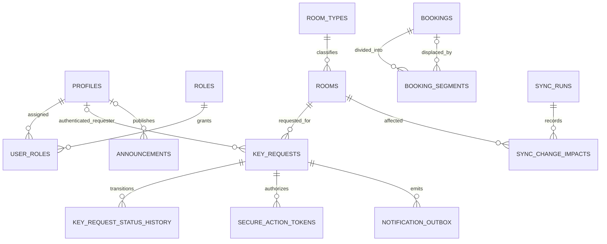

# ITD336 Baseline Database Redesign

## Purpose

This design incrementally extends the existing Supabase schema for the approved 50 FR and 12 NFR baseline. Existing migrations, operational rows, `bookings`, `key_loans`, and `room_keys` remain intact. No production database is modified by this work.

## Design boundaries

- New key-use requests are request-centric and do not require a physical key-copy record.
- A normal laboratory request may carry an anonymous identity snapshot. Special-room requests require a verified Supabase user.
- Meeting reservations remain in `bookings`; `booking_segments` represents the surviving and displaced intervals of a priority override.
- All conflict-sensitive transitions use database transactions, row/advisory locks, and range constraints.
- Action tokens are stored only as SHA-256 digests and are single-use with explicit expiry.
- Email delivery uses an idempotent outbox. A future worker owns external delivery.
- Timetable rows provide context and occupancy information but do not block key requests.
- Public history containing full names and emails is designed but not exposed until the privacy exception is confirmed.

## Additive model

## Security model

Direct writes to workflow tables are denied. Anonymous and authenticated clients use narrow `SECURITY DEFINER` RPCs. Admin transitions require existing permissions. Tokens are compared by digest, consumed under row lock, and never returned after issuance. Outbox claiming is restricted to `service_role`.

## Compatibility

Legacy key inventory and loan workflows remain available during transition. A compatibility view unifies baseline key requests with legacy loan history without changing existing frontend/backend calls. Later application work can move feature-by-feature to the new RPCs before legacy structures are deprecated.

## Known boundaries

- Northbkk SSO provider configuration and claim mapping are not present in the repository; database authorization relies on server-managed roles until configured.
- Public disclosure of full requester/lecturer email remains disabled.
- External email delivery, automation scheduling, and PDF/Excel generation are integration responsibilities, not database execution in this phase.
- No cloud migration or generated type refresh is performed until an approved test/link target exists.
